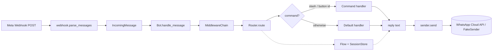

<div align="center">


# WhatsApp Bot

### A transport-agnostic, offline-testable WhatsApp Cloud API bot framework for Python.

**Built and maintained by [Viprasol Tech](https://viprasol.com).**

[](https://github.com/Viprasol-Tech/whatsapp-bot/actions/workflows/ci.yml)
[](https://www.python.org/)
[](https://mypy-lang.org/)
[](https://docs.astral.sh/ruff/)
[](#-testing)
[](LICENSE)
[](CHANGELOG.md)

</div>

---

WhatsApp Bot turns the raw, fiddly WhatsApp Cloud API into a clean, typed Python
framework. Webhook parsing, command routing, interactive buttons and lists, media
handling, per-user sessions, multi-step flows, and a middleware chain — all behind
small, pure interfaces. The transport is **injected**, so the entire bot runs and
tests offline with zero network, zero API keys, and zero WhatsApp account.

## ✨ Features

- 📨 **Webhook parsing** — turn Meta's JSON envelopes into typed `IncomingMessage`
  objects; status callbacks are skipped, malformed payloads fail loudly.
- 🔐 **Verification handshake** — the `GET` `hub.challenge` flow in one function.
- 🧭 **Command routing** — slash commands (`/help`, `/menu`, `/start`, `/ping`,
  `/about`) with a pluggable default handler.
- 🔘 **Interactive messages** — reply-button and sectioned list builders with the
  provider's documented limits validated up front.
- 🖼️ **Media handling** — parse image/audio/video/document/sticker references and
  build outgoing media messages.
- 👤 **Per-user sessions** — in-memory store with optional TTL and an injectable clock.
- 🪜 **Conversational flows** — a tiny, session-backed state machine for wizards.
- 🧅 **Middleware chain** — composable logging, rate-limiting, and keyword-blocking.
- 🧪 **Offline-first** — a `FakeSender` records sends; the CLI demos need no network.
- 🦾 **Strictly typed** — `mypy --strict` clean, `ruff` clean, fully docstringed.

## 🚀 Quickstart

```bash
# Clone and install (editable, with dev extras)
git clone https://github.com/Viprasol-Tech/whatsapp-bot.git
cd whatsapp-bot
pip install -e ".[dev]"

# See it work — no network, no credentials
whatsapp-bot demo          # route sample messages through a fake sender
whatsapp-bot flow          # walk a stateful multi-step signup wizard
whatsapp-bot interactive   # print button & list message payloads
whatsapp-bot middleware    # watch logging + rate-limiting in action
```

## 🧑‍💻 Usage

Wire a router to a sender and process a webhook payload end to end:

```python
from whatsapp_bot import Bot, FakeSender, default_router

bot = Bot(default_router(), FakeSender())
payload = {
    "object": "whatsapp_business_account",
    "entry": [{"id": "0", "changes": [{"field": "messages", "value": {
        "messaging_product": "whatsapp",
        "messages": [{"from": "15551230001", "type": "text", "text": {"body": "/menu"}}],
    }}]}],
}
replies = bot.process_webhook(payload)
print(replies[0].text)  # -> "Main menu:\n1. Talk to support\n..."
```

Build interactive replies and route taps like commands:

```python
from whatsapp_bot import build_button_message

payload = build_button_message(
    "15551230001",
    "How can we help?",
    [("/menu", "Main menu"), ("support", "Talk to a human")],
    footer="Viprasol Tech",
)
# When the user taps a button, IncomingMessage.command_text == the button id,
# so the same Router resolves it.
```

Drive a multi-step conversation with sessions + flows:

```python
from whatsapp_bot import Flow, SessionStore, StepResult
from whatsapp_bot.webhook import IncomingMessage

store = SessionStore()
signup = Flow("signup", store)

@signup.step("ask_name", start=True)
def ask_name(message, session):
    if not message.text.strip():
        return StepResult("What's your name?")
    session.set("name", message.text.strip())
    return StepResult("And your email?", next_step="ask_email")

@signup.step("ask_email")
def ask_email(message, session):
    if "@" not in message.text:
        return StepResult("That doesn't look right — try again:")
    session.set("email", message.text.strip())
    return StepResult(f"Thanks {session.get('name')}!", done=True)

signup.handle(IncomingMessage(sender="1", text="Ada"))         # -> "And your email?"
signup.handle(IncomingMessage(sender="1", text="ada@x.com"))   # -> "Thanks Ada!"
```

Wrap handling with middleware:

```python
from whatsapp_bot import Bot, FakeSender, MiddlewareChain, default_router
from whatsapp_bot import logging_middleware, rate_limit_middleware

chain = (
    MiddlewareChain()
    .use(logging_middleware(print))
    .use(rate_limit_middleware(max_per_window=5, window_seconds=60))
)
bot = Bot(default_router(), FakeSender(), middleware=chain)
```

## 🏗️ Architecture



## 📚 API reference

| Module | Key API | What it does |
| --- | --- | --- |
| `whatsapp_bot.webhook` | `parse_messages`, `parse_message`, `verify_challenge`, `IncomingMessage` | Parse webhook payloads; verify the `GET` handshake. |
| `whatsapp_bot.router` | `Router`, `default_router` | Map commands and interactive taps to reply text. |
| `whatsapp_bot.bot` | `Bot`, `Reply` | Glue parsing, middleware, routing, and sending. |
| `whatsapp_bot.sender` | `Sender`, `FakeSender`, `build_text_message` | Outbound transport interface + offline fake. |
| `whatsapp_bot.interactive` | `build_button_message`, `build_list_message`, `Button`, `ListRow`, `ListSection` | Build validated interactive messages. |
| `whatsapp_bot.media` | `Media`, `media_from_message`, `build_media_message` | Parse and build media messages. |
| `whatsapp_bot.session` | `Session`, `SessionStore` | Per-user state with optional TTL. |
| `whatsapp_bot.flow` | `Flow`, `Step`, `StepResult` | Session-backed conversational state machine. |
| `whatsapp_bot.middleware` | `MiddlewareChain`, `logging_middleware`, `rate_limit_middleware`, `keyword_block_middleware` | Cross-cutting message handling. |

## 🧪 Testing

```bash
ruff check .          # lint
ruff format .         # format
mypy src              # strict type-check
pytest -q             # 95 tests, all offline
```

## 🗺️ Roadmap

- [x] Webhook parsing + verification handshake
- [x] Command routing with a default handler
- [x] Interactive button & list builders
- [x] Media message parsing & builders
- [x] Per-user sessions with TTL
- [x] Conversational flow state machine
- [x] Composable middleware chain
- [ ] Async sender + `httpx`-based Cloud API transport
- [ ] Pluggable Redis / SQL session backends
- [ ] Template message builders (HSM)
- [ ] Webhook signature (`X-Hub-Signature-256`) verification

## ❓ FAQ

**Does this require a WhatsApp account or API keys to try?**
No. The framework is transport-agnostic; the `FakeSender` and CLI demos run fully
offline. Plug in a real HTTP `Sender` when you go live.

**Which web framework does it use?**
None — the parsing and verification functions are pure and take dictionaries, so
they drop into FastAPI, Flask, Django, or anything else.

**How do interactive button taps get routed?**
`IncomingMessage.command_text` returns the tapped reply id, so the same `Router`
that handles `/menu` text also handles a button whose id is `/menu`.

**Can a user be in two flows at once?**
Yes. Each `Flow` namespaces its step pointer inside the session, so flows coexist
without clobbering each other.

## 🤝 Contributing

Contributions are welcome! Please read [CONTRIBUTING.md](CONTRIBUTING.md) and our
[Code of Conduct](CODE_OF_CONDUCT.md). In short: fork, create a branch, keep
`ruff`, `mypy`, and `pytest` green, and open a pull request.

## Contact — Viprasol Tech Private Limited

- Website: [viprasol.com](https://viprasol.com)
- Email: [support@viprasol.com](mailto:support@viprasol.com)
- Telegram: [t.me/viprasol_help](https://t.me/viprasol_help) | WhatsApp: +91 96336 52112
- GitHub: [@Viprasol-Tech](https://github.com/Viprasol-Tech) | [LinkedIn](https://www.linkedin.com/in/viprasol/) | X [@viprasol](https://twitter.com/viprasol)

## License

[MIT](LICENSE) (c) 2025 Viprasol Tech Private Limited
