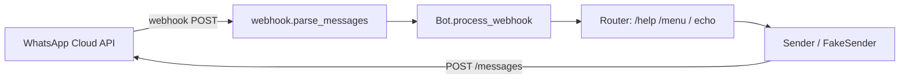

<p align="center">
  
</p>

<h1 align="center">WhatsApp Bot</h1>

<p align="center">
  <strong>A transport-agnostic WhatsApp Cloud API bot template — webhook parsing, command routing, and a fake sender — in Python.</strong><br>
  Parse webhooks into typed messages, route slash commands to replies, and test the whole flow offline.
</p>

<p align="center">
  <em>Built and maintained by <a href="https://viprasol.com">Viprasol Tech</a> — Fintech Experts. Full-Stack Builders.</em>
</p>

<p align="center">
  <a href="https://github.com/Viprasol-Tech/whatsapp-bot/actions/workflows/ci.yml"></a>
  <a href="LICENSE"></a>
  
  <a href="https://t.me/viprasol_help"></a>
  <a href="https://github.com/Viprasol-Tech/whatsapp-bot/stargazers"></a>
</p>

---

## ✨ Features

- 📨 **Webhook parsing** — turn a raw WhatsApp Cloud API payload into a typed `IncomingMessage` (sender, text, type, id).
- 🔐 **Verification handshake** — accept or reject the `GET` `hub.verify_token` challenge correctly.
- 🧭 **Command routing** — register `/help`, `/menu`, or any command; everything else hits an echo default.
- 🧪 **Offline by design** — `Sender` is a protocol with a `FakeSender` that records sends; no network in tests or demo.
- 🛡️ **Robust parsing** — status-only callbacks are skipped, malformed payloads raise (or are swallowed) cleanly.
- 🖥️ **CLI** — `whatsapp-bot demo` runs sample payloads through the bot with zero setup.
- ⚙️ **Modern tooling** — ruff, mypy (strict), pytest, GitHub Actions CI.

## 🚀 Quickstart

```bash
git clone https://github.com/Viprasol-Tech/whatsapp-bot.git
cd whatsapp-bot
python -m pip install -e ".[dev]"

# Process sample inbound messages offline:
whatsapp-bot demo

# Try the webhook verification handshake:
whatsapp-bot verify --token my-verify-token --challenge 12345
```

## 🧩 Wire your own bot

```python
from whatsapp_bot.bot import Bot
from whatsapp_bot.router import Router
from whatsapp_bot.sender import FakeSender
from whatsapp_bot.webhook import IncomingMessage

router = Router()

@router.command("/start")
def start(message: IncomingMessage) -> str:
    return f"Welcome, {message.contact_name or 'friend'}!"

bot = Bot(router, FakeSender())  # swap FakeSender for an HTTP sender in production
replies = bot.process_webhook(webhook_payload)
```

## 🏗️ Architecture



## 🗺️ Roadmap

- [x] Webhook parsing + verification challenge
- [x] Command router with default echo handler
- [x] Sender protocol + FakeSender + offline CLI demo
- [ ] HTTP sender adapter for the live Cloud API
- [ ] Interactive list/button message helpers
- [ ] Signature (`X-Hub-Signature-256`) verification

## 🤝 Contributing

PRs welcome — see [CONTRIBUTING.md](CONTRIBUTING.md) and our [Code of Conduct](CODE_OF_CONDUCT.md).

## Contact — Viprasol Tech Private Limited

- Website: [viprasol.com](https://viprasol.com)
- Email: [support@viprasol.com](mailto:support@viprasol.com)
- Telegram: [t.me/viprasol_help](https://t.me/viprasol_help) | WhatsApp: +91 96336 52112
- GitHub: [@Viprasol-Tech](https://github.com/Viprasol-Tech) | [LinkedIn](https://www.linkedin.com/in/viprasol/) | X [@viprasol](https://twitter.com/viprasol)

## License

[MIT](LICENSE) (c) 2025 Viprasol Tech Private Limited
